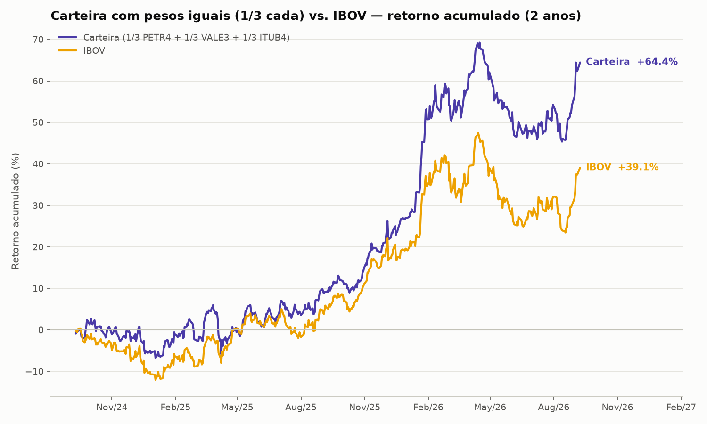
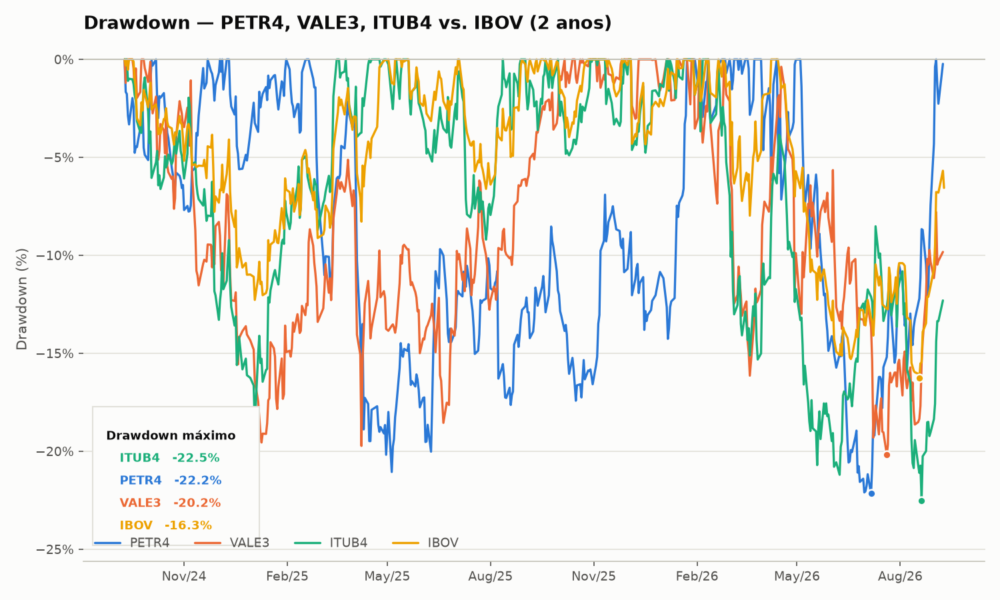
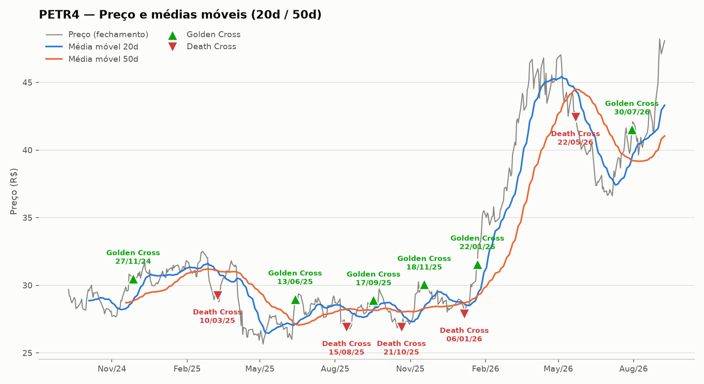
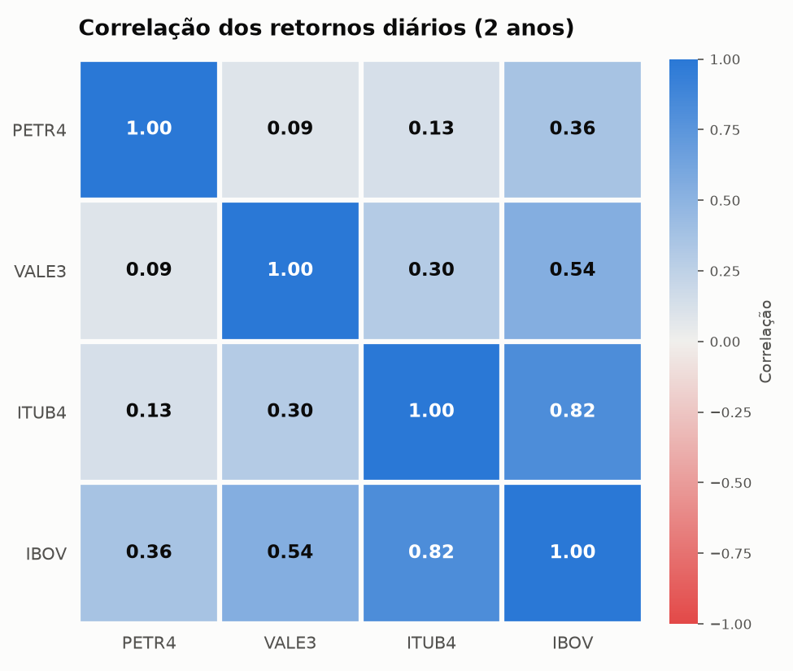

# 📈 Análise de Ações da B3 com Python

Pipeline de análise quantitativa de PETR4, VALE3, ITUB4 e do índice Ibovespa (IBOV): coleta de cotações, retornos, risco, correlação, médias móveis e simulação de carteira.

## O que o projeto faz

| Etapa | Script | Saída |
|---|---|---|
| Coleta 2 anos de cotações diárias (yfinance) | `baixar_cotacoes.py` | `cotacoes_2anos.csv` |
| Calcula retornos diários e acumulados | `calcular_retornos.py` | `retornos_2anos.csv`, `retorno_acumulado.png` |
| Volatilidade anualizada e drawdown máximo | `calcular_risco.py` | `risco_2anos.csv` |
| Gráfico de drawdown | `grafico_drawdown.py` | `drawdown.png` |
| Matriz de correlação entre ativos | `matriz_correlacao.py` | `correlacao_heatmap.png` |
| Médias móveis (20/50) e cruzamentos (golden/death cross) de PETR4 | `medias_moveis_petr4.py` | `medias_moveis_petr4.png` |
| Carteira de pesos iguais vs. IBOV | `carteira_pesos_iguais.py` | `carteira_vs_ibov.png` |

## Resultados






## Como rodar

```bash
git clone https://github.com/JoaoJordao27/analise-acoes-b3.git
cd analise-acoes-b3
python -m venv .venv
.venv\Scripts\activate        # Windows
pip install -r requirements.txt

python baixar_cotacoes.py
python calcular_retornos.py
python calcular_risco.py
```

Os CSVs e gráficos gerados já estão no repositório; os scripts os recriam.

## Tecnologias

Python · pandas · matplotlib · yfinance

## Licença

[MIT](LICENSE)
